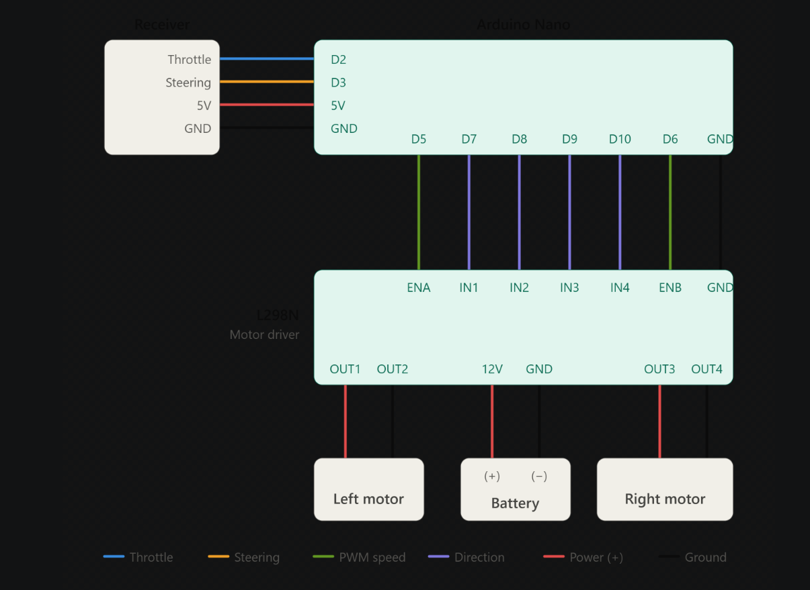

# Easy-Soccer-bot
A very simple two-motor soccer bot built using **Arduino Nano**, **L298N motor driver** and a standard **RC receiver/transmitter**. The Nano reads the throttle and steering pulses from the receiver and mixes them into left and right motor speeds.

> **This is an extremely simple sketch.** It is meant to be easy to read and easy to modify. See [Limitations](#limitations) before using it.

## Parts list

- Arduino NANO (Other development boards can be used aswell but may require code modification.)
- L298N motor driver (DUAL H-bridge.)
- 2x DC motors (Must be rated for your battery's output voltage.)
- Lipo/Li-ion batteries (Hardshell batteries are preferred as they can handle collisions better.)
- RC rx+tx (rx must have atleast 2 channels) (rx = receiver, tx = transmitter)
## Wiring

## Limitations

- **Blocking reads.** `pulseIn()` waits for each pulse before the sketch continues. The two channels are read one after the other, so the car updates roughly every 20-40 ms (about 25-50 times per second) with a standard 50 Hz receiver.
- **No timeout is set.** Because `pulseIn()` is called without a timeout, it waits up to its default of 1 second for a pulse. This keeps the sketch compatible with receivers that have a slow or unusual frame rate. A short timeout (for example 25 ms) would stop working on a receiver or transmitter whose pulses are further apart than that, so do not add one without checking your receiver's frame period first.
- **No failsafe.** If the receiver signal is lost (for example the transmitter is switched off while the receiver is still powered), `pulseIn()` returns 0 after its timeout. The code treats 0 as a very low pulse, so **the motors can drive at full speed in reverse**. 
- **Unclamped mixing.** `throttle + steer` can exceed 255 at full throttle plus full steering. `drive()` clamps the result, so the car still works, but turning at full speed is slightly less proportional.
- **Receiver-dependent.** Most RC receivers output a pulse of 1000-2000 us repeated about every 20 ms, but this varies by model. If something behaves oddly, check your receiver's output.

## First test

1. **Lift the car so the wheels are off the ground.**
2. Power up the transmitter first.
3. Push the throttle forward. Both wheels should spin forward.
4. If a wheel spins backwards, flip its `MOTOR_x_DIR`.
5. Steer right. The left wheel should speed up and the right wheel slow down. If it's the opposite, flip `STEER_GAIN`.
6. When finished, switch off the car first, then the transmitter.

## Troubleshooting

These issue can be the result of alot of causes, so its difficult to exactly pinpoint the cause that is why I mentioned only the most common causes.

**The motors don't move at all**
Check that the battery is properly connected or not. Also confirm ENA and ENB are connected properly.

**The motors only run at full speed**
The ENA/ENB jumpers are still on the L298N.

**The motors twitch or creep at rest**
Raise `DEADBAND` a little (try 40-50) or re-center the trim on your transmitter.

**A wheel spins the wrong way**
Flip `MOTOR_A_DIR` (left) or `MOTOR_B_DIR` (right). Swapping that motor's two wires does the same thing.

**The car steers the wrong way**
Flip `STEER_GAIN` between `1` and `-1`.

**Steering and throttle are swapped**
Swap the two signal wires or swap `THROTTLE_PIN` and `STEER_PIN` in the code.

**The car drives on its own when the transmitter is off**
Expected with this sketch, since it has no failsafe (see [Limitations](#limitations)). Switch the car off before the transmitter.

**The Nano resets when the motors start**
The motors are pulling the supply voltage down. Add a capacitor (around 470 µF) across the battery leads or power the Nano from a separate 5V source.

## Safety

- Always test with the wheels off the ground first.
- Never connect USB and an external 5V source to the Nano at the same time.
- The L298N gets hot under heavy load. Add a small cooling fan on the heatsink if you run big motors.
